<p align="center">
  
</p>

<table>
  <tr>
    <td width="65%" valign="top">
      <h1>Hi, I'm Zafira 👋</h1>
      <a href="https://github.com/zafiranurkamila">
        
      </a>
      <p>
        
        <a href="https://github.com/zafiranurkamila?tab=followers">
          
        </a>
      </p>
      <p>A final year student from Indonesia 🇮🇩 who loves building things end to end: APIs, web and mobile apps, automated tests, and deep learning models.</p>
      <p>Right now I'm wrapping up my thesis on <b>PVC localization from 12 lead ECG signals using CNNs</b>, and building a <b>3D voxel village portfolio</b> for fun.</p>
      <p>📫 <b>zafiranurkamila@gmail.com</b></p>
    </td>
    <td width="35%" valign="middle" align="center">
      
      <br/><br/>
      <a href="https://www.linkedin.com/in/zafiranurkamila/"></a>
      <a href="mailto:zafiranurkamila@gmail.com"></a>
    </td>
  </tr>
</table>

## About Me

```yaml
name: Zafira Nur Kamila
location: Indonesia
currently_working_on:
  - "Thesis: PVC localization (RVOT vs LVOT) with CNN + PSD, Wavelet & HOS features"
  - "An interactive 3D portfolio built with React Three Fiber"
experience:
  - "Building REST APIs with Laravel and Spring Boot"
  - "Building web apps with Next.js and React, and mobile apps with Flutter"
  - "Writing automated tests (PHPUnit, Katalon) and doing API testing"
  - "Training computer vision and signal models (TensorFlow, PyTorch, YOLOv8)"
currently_learning:
  - "Explainable AI (SHAP, permutation importance)"
  - "Rigorous model evaluation (patient level CV, multi seed runs, bootstrap)"
  - "3D on the web with Three.js"
fun_fact: "You can explore my portfolio and play mini games in it 🎮"
```

## Tech Stack

**Languages**
<p>
  
</p>

**Web & Mobile**
<p>
  
</p>

**AI & Machine Learning**
<p>
  
  <br/>
  
  
  
</p>

**Testing**
<p>
  
  
  
  
  
</p>

**Database & Tools**
<p>
  
</p>

## Featured Projects

<table>
  <tr>
    <td width="50%" valign="top">
      <h3>🫀 PVC Localization with CNN</h3>
      <p>
        <a href="https://github.com/zafiranurkamila/pvc-localization-cnn">
          
          
        </a>
      </p>
      <p>Compares <b>PSD, Wavelet (CWT) and Higher Order Statistics</b> features in a multi branch CNN to find where PVCs originate (RVOT vs LVOT) from 12 lead ECGs of 329 patients. Uses patient level 5 fold CV, multi seed runs, bootstrap confidence intervals and SHAP for explainability. The best model (PSD + Wavelet) reaches a <b>Macro F1 of 0.876</b> on the test set.</p>
      <p><b>Stack:</b> Python, PyTorch, SciPy, PyWavelets, scikit learn, SHAP</p>
    </td>
    <td width="50%" valign="top">
      <h3>🏡 Voxel Village Portfolio</h3>
      <p>
        <a href="https://github.com/zafiranurkamila/portfolio">
          
          
        </a>
      </p>
      <p>An interactive portfolio shaped like a voxel village. Walk around as my character, step into buildings to read about my work, chat with villagers, finish quests and play 3 mini games. Every texture, character and sound is generated in code, and the "Now Building" stage pulls my latest repos from GitHub automatically.</p>
      <p><b>Stack:</b> React, React Three Fiber, drei, Tailwind CSS, Web Audio API</p>
    </td>
  </tr>
  <tr>
    <td width="50%" valign="top">
      <h3>🤖 Woundify: AI Wound Classification</h3>
      <p>
        <a href="https://github.com/zafiranurkamila/woundify">
          
          
          
        </a>
      </p>
      <p>A mobile app that classifies wound types with deep learning, running inference on photos from the user's camera with a Java service for data management.</p>
      <p><b>Stack:</b> Java, Flutter, Python, TensorFlow</p>
    </td>
    <td width="50%" valign="top">
      <h3>💰 Finansialin: Personal Finance App</h3>
      <p>
        <a href="https://github.com/zafiranurkamila/finansialin-backend-laravel">
          
        </a>
        <a href="https://github.com/zafiranurkamila/finansialin-frontend">
          
        </a>
      </p>
      <p>A REST API and web app for managing personal finances: token auth (access + refresh), transaction tracking, budget planning, notifications and AI features, backed by feature tests.</p>
      <p><b>Stack:</b> Laravel 12, Next.js 14, PostgreSQL, PHPUnit, Google Generative AI</p>
    </td>
  </tr>
  <tr>
    <td width="50%" valign="top">
      <h3>📚 BooQu: Library Management</h3>
      <p>
        <a href="https://github.com/zafiranurkamila/booqu-spring-restful-api">
          
        </a>
        <a href="https://github.com/zafiranurkamila/booqu-frontend">
          
        </a>
      </p>
      <p>A library management system with book loans, JWT authentication, overdue tracking, and thorough validation and error handling on every endpoint.</p>
      <p><b>Stack:</b> Spring Boot, JPA/Hibernate, Spring Security, PostgreSQL, Maven</p>
    </td>
    <td width="50%" valign="top">
      <h3>🚭 Smoking Detection with YOLOv8</h3>
      <p>
        <a href="https://github.com/zafiranurkamila/smoking-detection-yolov8">
          
          
        </a>
      </p>
      <p>An object detection model that spots smoking activity in images and video using YOLOv8.</p>
      <p><b>Stack:</b> Python, YOLOv8, OpenCV</p>
    </td>
  </tr>
  <tr>
    <td width="50%" valign="top">
      <h3>🏆 TeluCup: Tournament Platform</h3>
      <p>
        <a href="https://github.com/zafiranurkamila/telucup-backend">
          
        </a>
      </p>
      <p>A tournament platform for match scheduling, team registration and bracket management.</p>
      <p><b>Stack:</b> PHP, Laravel, Blade, MySQL</p>
    </td>
    <td width="50%" valign="top">
      <h3>🏋️ GYMFIT: Fitness Landing Page</h3>
      <p>
        <a href="https://github.com/zafiranurkamila/GYMFIT">
          
        </a>
      </p>
      <p>A responsive landing page for a fitness brand with smooth animations, a dark theme and a mobile first layout.</p>
      <p><b>Stack:</b> HTML5, CSS3, JavaScript</p>
    </td>
  </tr>
</table>

<p align="center">
  <a href="https://github.com/zafiranurkamila?tab=repositories">
    
  </a>
</p>

## GitHub Stats

<div align="center">
  
  
</div>

<div align="center">
  
</div>

<div align="center">
  
</div>

## Journey

```
2026  ▰▰▰▰▰▰▰▰▰▰▰▰▰▰▰▰▰▰▰▰  Thesis (ECG + CNN + XAI), 3D portfolio, Woundify
2025  ▰▰▰▰▰▰▰▰▰▰▰▰▰▰▰▰░░░░  Spring Boot, Next.js, YOLOv8 & API testing
2024  ▰▰▰▰▰▰▰▰▰▰▰▰░░░░░░░░  Laravel, web development & frontend integration
2023  ▰▰▰▰▰▰▰▰░░░░░░░░░░░░  Java, PHP, C++ & database fundamentals
2022  ▰▰▰▰▰░░░░░░░░░░░░░░░  Wrote my first lines of code
```

## Let's Connect

<p align="center">
  <a href="https://www.linkedin.com/in/zafiranurkamila/" target="_blank">
    
  </a>
  <a href="https://instagram.com/kamila.zafira" target="_blank">
    
  </a>
  <a href="mailto:zafiranurkamila@gmail.com">
    
  </a>
  <a href="https://github.com/zafiranurkamila" target="_blank">
    
  </a>
</p>

<p align="center">
  <i>"We are what we repeatedly do." Aristotle</i>
</p>


